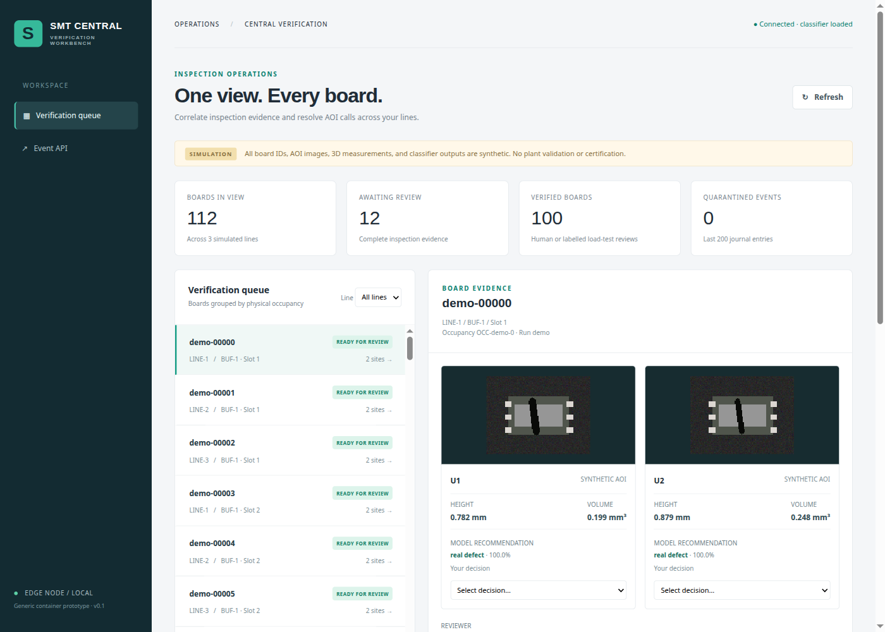
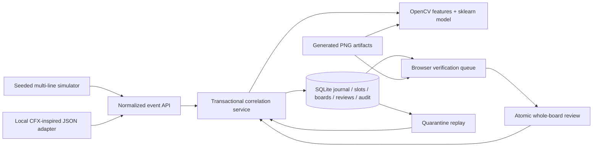

# SMT Central Verification Workbench

A local operator workbench that connects synthetic AOI images, 3D measurements, and board review decisions across simulated SMT lines.

[](https://github.com/MaheshBhushan/smt-central-verification-workbench/actions/workflows/check.yml)

[Run guide](docs/OPERATIONS.md) · [Validation](docs/VALIDATION.md) · [Design handoff](docs/IMPLEMENTATION_HANDOFF.md) · [HTTP load evidence](docs/evidence/http-load.json)



Inspection messages can arrive late, repeat, or refer to a slot that now holds another board. The workbench correlates every event with a run, board, line, buffer, slot, and occupancy token. SQLite transactions preserve the event journal and board state together. An operator reviews every declared site before a release event frees the slot.

OpenCV extracts actual image features. A scikit-learn random forest combines those features with numeric 3D measurements. A board-group split separates training boards from evaluation boards. Model suggestions remain separate from review decisions.

**All images, measurements, board identities, and model evaluation data are synthetic.** This repository demonstrates software behavior. It has no plant validation, IPC-CFX certification, Siemens Industrial Edge qualification, or machine-control integration.

## Run it

Install [uv](https://docs.astral.sh/uv/), then run:

```sh
git clone https://github.com/MaheshBhushan/smt-central-verification-workbench.git
cd smt-central-verification-workbench
uv sync --locked --python 3.12 --extra dev
uv run smt-workbench demo --boards 120
uv run smt-workbench serve
```

Open **http://127.0.0.1:8080**. Select a board, inspect both sites, choose each decision, enter your name and reason, and submit. Release the reviewed board with the simulation control. The demo includes clearly labelled automated fixture reviews so the queue contains ready, reviewed, and released boards.

The ignored `runtime/` directory holds generated images, the database, and the trusted local model. Training uses seed 17; the default operational simulation uses seed 73. Use a new `--run-id` for a new scenario. Restart the server after retraining.

## Exercise the failure cases

```sh
uv run pytest -q
uv run smt-workbench load-test --boards 100 --run-id load-02
# Keep the server running in another terminal for this real HTTP check:
uv run python scripts/http_acceptance.py --boards 25 --run-id http-02
```

The fault simulator delivers evidence before arrival, repeats event IDs, replays quarantine, and injects an identity conflict. Focused tests also cover competing slot claims, stale slot occupancy, atomic and idempotent reviews, path traversal, checksums, model unavailability, and event immutability.

The HTTP script uses bounded concurrency and unique slots. It records status counts, latency percentiles, and terminal board states. Its automated load reviews explicitly identify themselves. They do not represent human verification.

## Observed results

These measurements come from a local run on a mounted Linux workspace. They provide reproducibility evidence for this prototype. They do not predict production throughput or inspection accuracy.

| Check | Observed result | Evidence |
| --- | --- | --- |
| Focused acceptance suite | 16 passing tests | [Validation notes](docs/VALIDATION.md) |
| 12-board fault simulation | 4 initial quarantines recovered, 12 duplicate deliveries, 1 rejected identity conflict | [JSON](docs/evidence/fault-demo.json) |
| 100-board service load | 100 released; 34 initial quarantines recovered | [JSON](docs/evidence/service-load.json) |
| Real HTTP load | 25 boards, 180 POSTs, concurrency 4; all checks passed | [JSON](docs/evidence/http-load.json) |
| HTTP latency | p50 378 ms, p95 792 ms, p99 3362 ms; 8.08 requests/s | [Method and counts](docs/evidence/http-load.json) |
| Synthetic model evaluation | 60 held-out site samples from 30 boards; 60 correct | [Grouped evaluation](docs/evidence/model-evaluation.json) |

The synthetic generator deliberately produces easy cracks, highlights, and measurement distributions. A perfect result on this small generated set does not establish real defect detection quality. Calibration, class imbalance, drift, and production false-call rates remain untested.

## Architecture



Board workflow: `COLLECTING → READY_FOR_REVIEW → REVIEWED → RELEASED`.

An exact event retry produces no additional transition. Changed content under the same event ID returns 409. Missing dependencies enter quarantine with 202. Invalid input returns 422. A review includes every expected site and uses its own idempotency key. Review state and all site decisions commit atomically.

The local JSON adapter uses IPC-CFX/M2M concepts. It has no broker transport or official schema compatibility. The container provides a generic edge deployment unit. [Operations](docs/OPERATIONS.md) documents the boundaries and API examples.

## Container

```sh
docker compose build
docker compose run --rm workbench demo --boards 120
docker compose up -d
```

The service runs as an unprivileged user and publishes its port on localhost. A named volume retains generated evidence and reviews. See [validation notes](docs/VALIDATION.md) for the container checks performed on this host.

## Project files

- `src/smt_workbench/`: event contracts, persistence, correlation, vision, simulator, API, and static UI.
- `tests/test_workbench.py`: runnable acceptance cases.
- `scripts/http_acceptance.py`: bounded concurrent HTTP traffic and checks.
- `docs/evidence/`: measured JSON results; no generated dataset or trained model is committed.
- `docs/IMPLEMENTATION_HANDOFF.md`: planning specification; [validation notes](docs/VALIDATION.md) record implementation choices and limits.

Potential next steps require a real plant partner: machine adapters, representative labelled data, calibration, authenticated operator identity, TLS, retention, model monitoring, and platform-specific edge packaging. The prototype uses one SQLite writer and loads all boards into the UI. Larger deployments need measured pagination and throughput work.

MIT licensed. Created by [Mahesh Koduri](https://github.com/MaheshBhushan).
